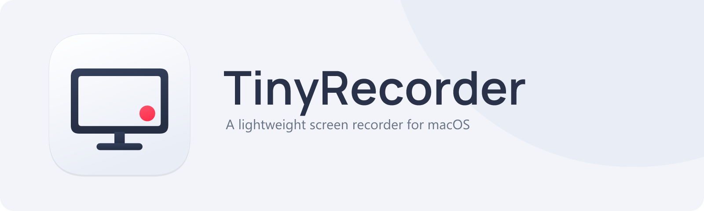

<p align="center">

</p>
<h3 align="center">輕巧的 macOS 螢幕錄影工具，已支援 macOS 27</h3>
<p align="center">
<a href="https://www.tinyrecorder.app/zh-Hant/"><b>官方網站：www.tinyrecorder.app</b></a>
</p>
<p align="center">
<a href="../README.md">English</a> · <a href="README.zh-CN.md">简体中文</a> · <b>繁體中文</b> · <a href="README.it.md">Italiano</a> · <a href="README.ja.md">日本語</a> · <a href="README.de.md">Deutsch</a> · <a href="README.es.md">Español</a>
</p>

> **TinyRecorder** 是由社群接手維護的 [QuickRecorder](https://github.com/lihaoyun6/QuickRecorder) 分支，原專案由 [lihaoyun6](https://github.com/lihaoyun6) 開發，自 2025 年年中起已停止更新。
> 此分支著重於**與最新 macOS 版本的相容性**（從 macOS 27「Golden Gate」開始）。

## 此分支修正了哪些問題

- ✅ **macOS 27 上選單列的錄製控制項（停止／暫停／攝影機）無法回應**：原專案議題 [#295](https://github.com/lihaoyun6/QuickRecorder/issues/295)／[#296](https://github.com/lihaoyun6/QuickRecorder/issues/296)。根本原因：在 macOS 27 上，無論指標實際位於何處，`locationInWindow` 一律回報為 `NSStatusItem` 視窗的中心點；因此 SwiftUI 的點擊判定永遠只會觸發位於中央的控制項。修正方式是透過 `NSEvent.mouseLocation` 取得指標的實際位置，重新建立滑鼠事件。

## 可以錄製什麼

- 整個螢幕、選取的區域、一個或多個視窗，或單一應用程式
- 只錄系統聲音，可選擇是否同時收錄麥克風
- **連接的 iPhone 或 iPad**：詳見下方說明
- 錄影時顯示攝影機懸浮視窗與「發表人置前」（macOS 14 以上版本）

### 錄製 iPhone／iPad

TinyRecorder 可以錄製連接到 Mac 的 iPhone 或 iPad 螢幕。它是在 Mac 上執行的應用程式，並非 iOS App。

1. 以 USB 傳輸線連接裝置，解鎖後若出現提示，請點一下「**信任**」。
2. 在 TinyRecorder 的錄製工具列中，按一下**錄製行動裝置**，即會列出已連接的裝置。
3. 視需要開啟**靜音**並選擇**預設**（畫質），然後按一下裝置名稱即可開始錄影。

macOS 會將裝置視為外接攝影機，因此需要的是**相機**權限（而非螢幕錄製權限）。如果清單中沒有出現裝置，請重新連接傳輸線，並確認裝置已解鎖。

## 系統需求

- macOS 12.3 或以上版本

## 安裝

### 方式一：一行指令安裝（推薦，不會出現 Gatekeeper 警告）

打開「終端機」，貼上以下指令並按下 Return 鍵：

```bash
curl -fsSL https://raw.githubusercontent.com/33to9/TinyRecorder/main/install.sh | bash
```

此指令碼會從 GitHub 下載最新版本，驗證其 SHA-256，安裝到「應用程式」檔案夾並打開。以 curl 下載的檔案不帶隔離標記，因此 macOS 不會阻擋首次啟動。指令碼很短，歡迎先[閱讀內容](../install.sh)。

### 方式二：Homebrew

```bash
brew install --cask 33to9/tap/tinyrecorder
```

### 方式三：DMG

從 [Releases](https://github.com/33to9/TinyRecorder/releases/latest) 下載最新的 `TinyRecorder_vX.Y.Z.dmg`，打開後將 TinyRecorder 拖移到「應用程式」檔案夾。

由於此應用程式未經 Apple 公證，macOS 會阻擋一次首次啟動：
- **macOS 15 及以上版本**：按兩下應用程式（會出現警告），接著打開「**系統設定**」→「**隱私權與安全性**」，向下捲動並按一下「**強制打開**」
- **macOS 12–14**：在應用程式上按右鍵 →「**打開**」

### 更新

在應用程式中使用**檢查程式更新…**即可：不必自行下載，不會出現 Gatekeeper 警告，權限也會保留。

## 所需權限

| 權限 | 用途 |
|---|---|
| 螢幕錄製 | 錄製螢幕／視窗／應用程式／系統聲音 |
| 麥克風 | 錄下你的聲音 |
| 相機 | 攝影機懸浮視窗／發表人置前／錄製 iPhone 或 iPad |

### 首次啟動設定

首次啟動時，會出現簡短的逐步設定導引：

1. **螢幕錄製**：按一下**開始授權**，然後在「**系統設定**」→「**隱私權與安全性**」→「**螢幕與系統錄音**」中開啟 **TinyRecorder**。導引顯示綠色勾號後，TinyRecorder 會在 3 秒後自動重新啟動（也可以立即重新啟動）。
2. **麥克風**（選用）：如果需要旁白，建議現在就允許，以免第一次錄影被系統提示中斷。
3. **預設格式**：H.265／H.264 與 MP4／MOV，之後可在偏好設定中變更。
4. **開始使用**：告訴你從哪裡開始錄影（選單列圖示／Dock），並打開錄製工具列。

### 更新後權限導引一直出現

從 v1.7.15 起，應用程式改用固定憑證簽署，因此透過應用程式內更新會保留權限。通常只有從舊版本更新時才會遇到這個情況。

如果 TinyRecorder 的開關已經開啟、無法保持開啟，或是每個按鈕仍會打開權限導引，代表 macOS 中的權限紀錄屬於舊版本（macOS 會將權限與應用程式的程式碼簽章綁定，而簽章已經變更）。可用以下任一方式解決：

- 在權限導引中按一下**重設授權並重新啟動**，然後重新授予權限；或
- 「**偏好設定**」→「**一般設定**」→「**權限**」→**修復螢幕錄製權限**；或
- 結束 TinyRecorder，在「終端機」中執行 `tccutil reset ScreenCapture com.33to9.TinyRecorder`，再重新打開 TinyRecorder 並授予權限。

## 從原始碼建置

需求：Xcode 15 以上版本（含 macOS SDK）。

```bash
git clone https://github.com/33to9/TinyRecorder.git
cd TinyRecorder
open TinyRecorder.xcodeproj
# 選擇 TinyRecorder scheme 後建置（⌘B / ⌘R）
```

CI 透過 GitHub Actions（`.github/workflows/build.yml`）建置：推送 `v*` 標籤即可發佈 Release。

## 授權與致謝

本專案採用 **AGPL-3.0** 授權（詳見 [LICENSE](../LICENSE)）。

- 原始專案：[QuickRecorder](https://github.com/lihaoyun6/QuickRecorder) — Copyright © 2024 [lihaoyun6](https://github.com/lihaoyun6)
- 螢幕錄製引擎部分源自 @Mnpn 開發的 [Azayaka](https://github.com/Mnpn/Azayaka)
- 分支維護者：[33to9](https://github.com/33to9) — Copyright © 2026
